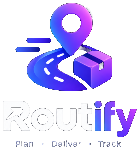
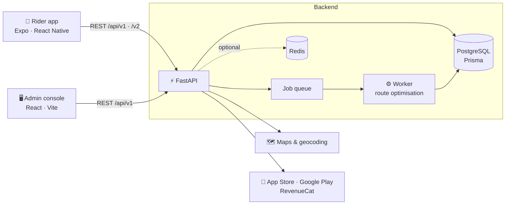

<p align="center">
  
</p>

<h1 align="center">Routify</h1>

<p align="center">
  <b>Route planning and delivery management for independent couriers</b><br />
  Import your parcels, get the best stop order, deliver with proof, and close the day with a PDF report — all from one app.
</p>

<p align="center">
  
  
  
  <a href=".github/workflows/ci.yml"></a>
</p>

<p align="center">
  
  
  
  
  
  
</p>

> [!NOTE]
> Routify is under active development. Branding, naming and visuals are still being finalised with the client and may change.

---

## 📱 Screens

<p align="center">
  
  
  
  
</p>

<p align="center"><sub>Design previews — the full set lives in <a href="design_pref/"><code>design_pref/</code></a>.</sub></p>

## ✨ Features

**For riders (mobile app)**
- 📥 **Add stops your way** — import a PDF / Excel / Word manifest, type an address, drop a pin, speak it, or **scan an Eircode / barcode** with the camera (on-device OCR)
- 🧭 **Optimised routes** — best stop order for hundreds of stops, with map preview and live navigation
- ✅ **Proof of delivery** — photo capture, delivered / failed outcomes with reasons, duplicate-stop detection
- 📶 **Works offline** — actions queue in a local SQLite outbox and sync automatically when the signal comes back
- 📄 **Daily PDF reports** and full route history
- 💳 **Subscriptions** — in-app plans through the App Store and Google Play (RevenueCat)
- 🔄 **Over-the-air updates** with EAS Update

**For platform staff (admin console)**
- Overview dashboard, riders, deliveries, reports, plans, subscriptions and payments
- Audit logs and platform settings

**Under the hood**
- Background job worker for heavy route optimisation (never blocks the API)
- Geocoding cache, idempotency keys, rate limiting and token rotation
- `Server-Timing` headers, Sentry error reporting and performance benchmarks ([`perf.md`](perf.md))
- Self-hosted **OSRM + VROOM** road-routing proof of concept for Ireland ([`infra/routing`](infra/routing))

## 🏗️ Architecture



## 📂 Repository structure

| Path | What it is |
|:--|:--|
| [`rider-app/`](rider-app) | Rider mobile app — Expo + React Native + TypeScript |
| [`admin-web/`](admin-web) | Platform admin console — React + TypeScript + Vite |
| [`backend-py/`](backend-py) | REST API — Python + FastAPI + Prisma + PostgreSQL, with a background worker |
| [`infra/routing/`](infra/routing) | OSRM + VROOM self-hosted routing benchmark (Ireland) |
| [`infra/loadtest/`](infra/loadtest) | k6 and Locust load-test scenarios |
| [`design_pref/`](design_pref) | UI design references for every rider screen |
| [`render.yaml`](render.yaml) | Render blueprint for deploying the API |

## 🚀 Getting started

**Prerequisites:** Python 3.13, Node.js 24, and a PostgreSQL database (a hosted [Neon](https://neon.tech) database works, no Docker needed).

<details open>
<summary><b>Backend</b> — <code>backend-py/</code></summary>

```bash
cd backend-py
python -m venv .venv && source .venv/bin/activate   # Windows: .venv\Scripts\activate
pip install -r requirements-dev.txt
cp .env.example .env            # set DATABASE_URL and the JWT / refresh / file-signing secrets
prisma migrate deploy           # create the tables
python -m scripts.seed_admin    # needs ADMIN_EMAIL + ADMIN_PASSWORD (10+ chars) in .env
python -m app                   # API on http://localhost:4000
python -m app.worker            # route-optimisation worker (separate terminal)
pytest                          # tests run against a real PostgreSQL
```
</details>

<details>
<summary><b>Admin console</b> — <code>admin-web/</code></summary>

```bash
cd admin-web
cp .env.example .env            # VITE_API_URL=http://localhost:4000
npm install
npm run dev
```
</details>

<details>
<summary><b>Rider app</b> — <code>rider-app/</code></summary>

```bash
cd rider-app
cp .env.example .env            # EXPO_PUBLIC_API_URL=http://<your-machine-ip>:4000
npm install
npx expo start
```

**Shipping a JS-only fix without a store release (EAS Update):**

```bash
npx eas-cli@latest update --channel production --environment production --message "<what changed>"
```

The runtime version is a fingerprint of the native code, so an update never reaches a build with different native modules. After a native change (new module or `app.json` plugin), make a new build instead.
</details>

## 🧪 Quality

Every push and pull request runs [CI](.github/workflows/ci.yml):

| App | Checks |
|:--|:--|
| Backend | `ruff` lint + `pytest` against a throwaway PostgreSQL container |
| Rider app | `tsc` type-check + `expo lint` + unit tests |
| Admin console | `tsc` type-check + lint |

## 🧰 Tech stack

| Layer | Technology |
|:--|:--|
| Mobile | React Native 0.86, Expo SDK 57, React Navigation, TanStack Query, Expo SQLite, Vision Camera + OCR, React Native Maps |
| Admin | React 19, TypeScript, Vite |
| API | Python, FastAPI, Pydantic, Prisma (prisma-client-py), PostgreSQL |
| Auth | JWT access tokens + rotating refresh tokens, bcrypt |
| Payments | App Store Server API, Google Play Developer API, RevenueCat |
| Ops | Render, Neon, Redis (optional), Sentry, GitHub Actions, EAS Build & Update |

## 👤 Author

Built by **[Ali Sulman](https://github.com/alisulmanpro)** — Full-Stack AI Developer.

<p>
  <a href="https://github.com/alisulmanpro"></a>
  <a href="https://linkedin.com/in/ali-sulman-077682374/"></a>
</p>

---

<p align="center"><sub>© Routify. All rights reserved. This is a private client project; the source is shared for portfolio purposes.</sub></p>
